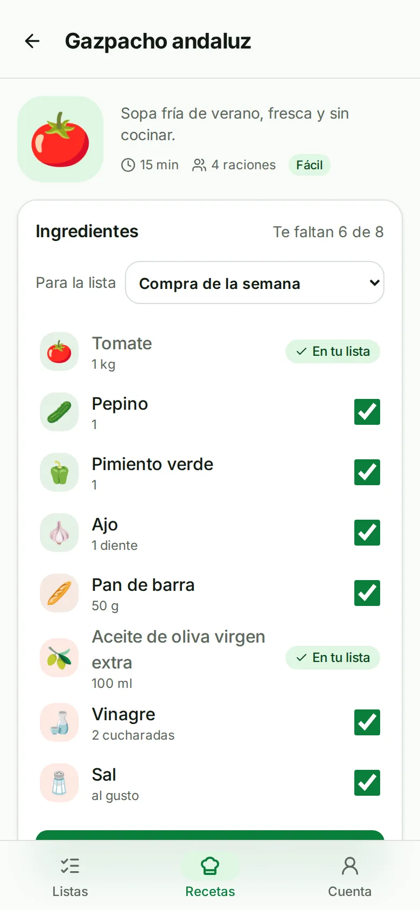
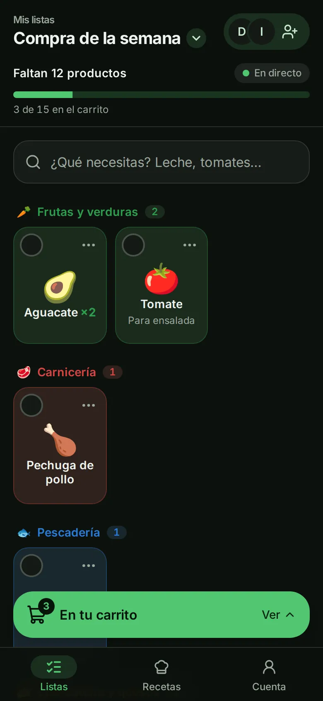
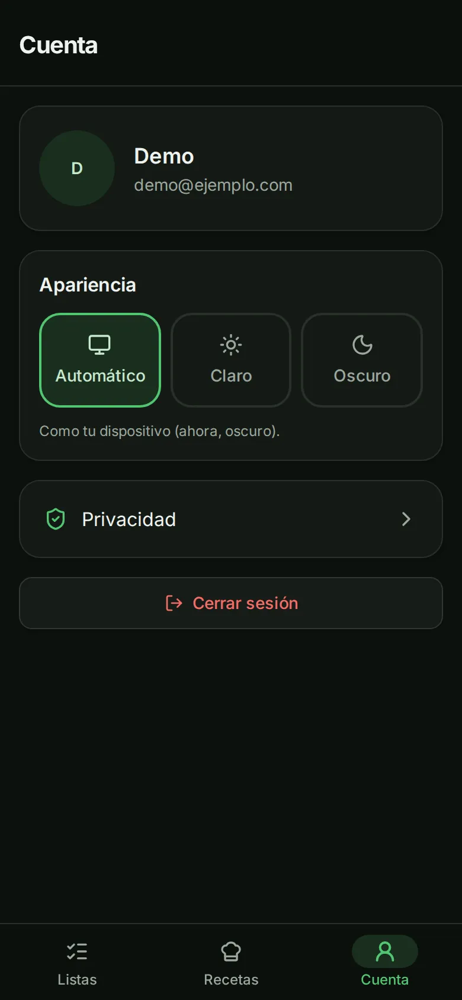
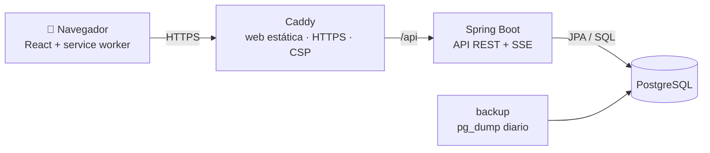

# ¿Qué falta? · Lo que falta en casa, a un toque

[](https://github.com/EloyRomero19/supermercado-app/actions/workflows/ci.yml)

Web para hacer la compra en compañía. Creas una lista, la compartes con tu familia o tus compañeros
de piso con un QR o un enlace, y cada uno añade lo que falta en casa. En el súper, al meter algo en
el carro se marca al instante en el móvil de todos, en **tiempo real**. Además trae un recetario que
te dice qué ingredientes te faltan y los añade a la lista de una vez.

Funciona en cualquier navegador, está pensada primero para el móvil y se puede añadir a la pantalla
de inicio como una app (PWA).

<table>
  <tr>
    <td></td>
    <td></td>
    <td></td>
    <td></td>
  </tr>
  <tr>
    <td align="center"><sub>Inicio de sesión</sub></td>
    <td align="center"><sub>Lo que falta, por secciones</sub></td>
    <td align="center"><sub>Cambiar de lista</sub></td>
    <td align="center"><sub>El carrito</sub></td>
  </tr>
  <tr>
    <td></td>
    <td></td>
    <td></td>
    <td></td>
  </tr>
  <tr>
    <td align="center"><sub>Recetas: qué te falta</sub></td>
    <td align="center"><sub>Modo oscuro</sub></td>
    <td align="center"><sub>Claro, oscuro o automático</sub></td>
    <td></td>
  </tr>
</table>

## Qué se puede hacer

- **Cuenta** con email y contraseña.
- **Varias listas** (casa, piso de la playa…), cada una con su propietario y sus miembros. La pestaña
  Listas abre directamente la que estás usando; las demás se cambian desde el título («Mis listas ▾»).
- **Compartir** con un código QR o un enlace de invitación. El propietario puede renovar el código o
  expulsar miembros.
- **Buscador** de un catálogo de 220 productos en 13 secciones del súper, tolerante a tildes y erratas
  («platano», «yogurt»). Lo que no esté en el catálogo se escribe a mano y la app le deduce un icono y
  una sección.
- **Lista agrupada por secciones**, en el orden de los pasillos, con cantidad y nota por producto.
  «Utilizados recientemente» permite volver a añadir algo con un toque.
- **Tiempo real**: lo que añade, cambia o marca cualquier miembro aparece al momento en los demás.
- **Carrito**: un toque mete un producto en el carro, con su confirmación y «Deshacer». Al terminar,
  «Terminar la compra» deja la lista con lo que falte para la próxima vez.
- **Recetas**: 15 platos típicos; cada uno dice qué ingredientes te faltan en tu lista y los añade
  todos de una vez, con la cantidad en la nota.
- **Modo claro, oscuro o automático**, avisos de falta de conexión e indicador «En directo».
- **Se puede añadir a la pantalla de inicio** y carga rápido gracias a la caché del *service worker*.

## Tecnologías y lenguajes

Es un *monorepo* con dos aplicaciones: el **backend** (la API, en Java) y el **frontend** (la web,
en TypeScript), más la configuración para ejecutarlo todo con Docker.

### Lenguajes

| Lenguaje | Dónde se usa | Para qué |
|---|---|---|
| **Java 21** | `backend/` (~4 900 líneas) | La API: reglas de negocio, seguridad, acceso a datos y tiempo real. Usa `record` para los datos de entrada y salida. |
| **TypeScript** | `frontend/src/` (~4 400 líneas) | Toda la web. Es JavaScript con tipos: el compilador avisa de errores antes de ejecutar (p. ej. un campo mal escrito en una respuesta de la API). |
| **SQL** (PostgreSQL) | `backend/src/main/resources/db/migration/` | El esquema de la base de datos, el catálogo y las recetas (migraciones de Flyway) y las búsquedas de productos. |
| **CSS** (Tailwind) | `frontend/src/index.css` y clases en los componentes | El diseño: colores, modo oscuro, animaciones. |
| **HTML / JSX** | `frontend/index.html` y los componentes `.tsx` | La estructura de las pantallas. |
| **Shell** | `backup/` | Las copias de seguridad automáticas y su restauración. |
| **YAML** | `docker-compose*.yml`, `.github/workflows/`, `application.yml` | Configuración de Docker, de la integración continua y de Spring. |

### Backend: la API

| Tecnología | Qué hace en el proyecto |
|---|---|
| **Spring Boot 4.1** | El *framework* de la API. Arranca el servidor web, conecta las piezas (inyección de dependencias) y da la configuración por defecto. Código organizado por funcionalidad (`auth`, `list`, `item`, `recipe`…) y en capas: *Controller* → *Service* → *Repository*. |
| **Spring Web MVC** | Los *endpoints* REST bajo `/api` (JSON). Los errores se devuelven en el formato estándar *Problem Details* (RFC 9457). |
| **Spring Security** | Protege la API. Valida en cada petición el *token* JWT (*OAuth2 Resource Server*). Contraseñas cifradas con **BCrypt**. |
| **JWT** (HS256) | El *access token*: dura 15 minutos y el navegador lo guarda **solo en memoria**. Para renovarlo hay un *refresh token* en una cookie `HttpOnly` que rota en cada uso. |
| **Spring Data JPA / Hibernate** | Guardar y leer entidades (usuarios, listas, productos de la lista) sin escribir SQL a mano. Bloqueo optimista (`@Version`) para que dos ediciones simultáneas no se pisen. |
| **JdbcClient** | SQL directo donde conviene: la búsqueda de productos y las recetas. |
| **Bean Validation** | Comprueba los datos de entrada (email válido, nombre no vacío, cantidades…) antes de llegar a la lógica. |
| **Server-Sent Events (SSE)** | El tiempo real. Cada navegador mantiene abierta una conexión con su lista y el servidor le envía cada cambio en cuanto se confirma en la base de datos. |
| **Flyway** | Versiona el esquema de la base de datos: cada cambio es un archivo `V{n}__descripcion.sql` que se aplica solo al arrancar. |
| **Spring Boot Actuator** | El *endpoint* `/actuator/health`, que Docker usa para saber si la API está lista. |
| **Lombok** | Ahorra código repetitivo (constructores, *getters*). |
| **Maven** | Compila, gestiona las dependencias y ejecuta los tests (`./mvnw`). |

### Base de datos

| Tecnología | Qué hace |
|---|---|
| **PostgreSQL 18** | Guarda usuarios, listas, miembros, productos, recetas y *tokens*. Identificadores `uuid` y fechas `timestamptz`. |
| **`pg_trgm` + `unaccent`** | Extensiones de PostgreSQL para el buscador: ignorar tildes y encontrar productos aunque tengan erratas (similitud por trigramas). |

### Frontend: la web

| Tecnología | Qué hace en el proyecto |
|---|---|
| **React 19** | La interfaz por componentes: cada pieza (tarjeta de producto, carrito, selector de listas…) es una función que pinta su parte según los datos. |
| **Vite 8** | Servidor de desarrollo instantáneo y *build* de producción optimizado. En desarrollo hace de *proxy* de `/api` hacia el backend. |
| **React Router 8** | La navegación entre pantallas (`/listas/:id`, `/recetas`, `/cuenta`…) sin recargar la página. |
| **Tailwind CSS 4** | Estilos con clases de utilidad. Los colores y medidas están en *tokens* (variables CSS en OKLCH, con contraste AA comprobado) y el modo oscuro solo cambia esas variables. |
| **shadcn/ui + Radix UI** | Componentes accesibles (paneles inferiores, modales, menús, diálogos de confirmación). Radix se encarga del foco, del teclado y de los lectores de pantalla. |
| **lucide-react** | Los iconos. Los productos usan emojis. |
| **sonner** | Los avisos (*toasts*) con «Deshacer». |
| **Inter** | La tipografía, incluida en la app (no se descarga de Google). |
| **@microsoft/fetch-event-source** | Cliente de SSE que permite enviar el *token* en la cabecera `Authorization` y se reconecta solo. |
| **qrcode.react** | Genera el QR de invitación. |
| **vite-plugin-pwa (Workbox)** | El manifiesto, los iconos, las pantallas de inicio de iPhone y el *service worker*, que guarda en caché la web (nunca los datos de la API) y avisa cuando hay versión nueva. |

### Infraestructura y calidad

| Tecnología | Qué hace |
|---|---|
| **Docker y Docker Compose** | En desarrollo, PostgreSQL. En producción, todo: base de datos, API, copias de seguridad y servidor web, cada uno en su contenedor. |
| **Vercel** (opcional) | Otra forma de publicarla sin servidor propio: la web como sitio estático y la API como contenedor (`backend/Dockerfile.vercel`), con la base de datos en Neon. |
| **Caddy** | Servidor web de producción. Sirve la web, reenvía `/api` al backend, obtiene y renueva solo el certificado HTTPS (Let's Encrypt) y añade las cabeceras de seguridad (CSP, HSTS…). |
| **JUnit 5 + Testcontainers** | Más de 100 tests de integración del backend contra un PostgreSQL real que se crea y se destruye en cada ejecución. |
| **Vitest** | Tests de la lógica del frontend (orden de los productos, ingredientes que faltan, eventos en tiempo real…). |
| **oxlint** | Revisa el código TypeScript en busca de errores y malas prácticas. |
| **GitHub Actions** | Integración continua: en cada *push* ejecuta los tests de backend y frontend, el *lint* y el *build*. |

## Cómo funciona por dentro



1. Caddy sirve la web (archivos estáticos) y todo lo que empieza por `/api` lo reenvía al backend.
   Web y API comparten dominio, así que no hace falta CORS y la cookie puede ser `SameSite=Strict`.
2. La web llama a la API con el *token* JWT en la cabecera `Authorization`. Si caduca, lo renueva sola
   con la cookie (una sola renovación a la vez, también entre pestañas).
3. Cuando alguien cambia una lista, el servicio guarda el cambio y publica un evento. **Solo cuando la
   transacción se confirma**, el evento se envía por SSE a los demás miembros conectados.
4. El servicio comprueba en cada operación que el usuario es miembro de la lista; a quien no lo es se
   le responde 404, para no revelar ni siquiera que la lista existe.

## Seguridad

- Contraseñas con BCrypt; mensaje de error genérico al iniciar sesión.
- *Access token* solo en memoria (nunca en `localStorage`); *refresh token* en cookie
  `HttpOnly; Secure; SameSite=Strict`, guardado en la base de datos como hash SHA-256, con rotación
  y revocación de toda la sesión si se reutiliza uno antiguo (señal de robo).
- Autorización por lista en la capa de servicio y productos buscados siempre por `(lista, producto)`.
- Límite de peticiones en login, registro y renovación de sesión (por IP) y al unirse a listas (por usuario).
- En producción: HTTPS obligatorio, CSP estricta (solo scripts propios), base de datos sin puertos
  expuestos y la API ejecutándose sin permisos de administrador dentro de su contenedor.

## Estructura del proyecto

```
├── backend/                Spring Boot (Java)
│   └── src/main/
│       ├── java/com/miapp/backend/
│       │   ├── auth/       registro, login, JWT, refresh token
│       │   ├── user/       usuarios
│       │   ├── list/       listas, miembros, invitaciones
│       │   ├── item/       productos de cada lista
│       │   ├── product/    catálogo y buscador
│       │   ├── recipe/     recetario
│       │   ├── realtime/   tiempo real (SSE)
│       │   ├── ratelimit/  límite de peticiones
│       │   └── common/     errores, eventos, utilidades
│       └── resources/db/migration/   esquema, catálogo y recetas (Flyway)
├── frontend/               React + TypeScript
│   └── src/
│       ├── api/            cliente de la API (token, renovación)
│       ├── auth/           sesión y rutas protegidas
│       ├── pages/          pantallas
│       ├── layout/         estructura común y barra inferior
│       ├── components/     componentes reutilizables (y ui/ de shadcn)
│       ├── items/          lista, carrito, recientes
│       ├── lists/          selector de listas, invitaciones, tiempo real
│       ├── products/       buscador y secciones del catálogo
│       ├── recipes/        lógica de recetas
│       ├── theme/          modo claro/oscuro
│       ├── lib/            utilidades y validación de formularios
│       └── pwa/            instalación y actualizaciones
├── backup/                 copias de seguridad (backup.sh, restore.sh)
├── docker-compose.yml      PostgreSQL para desarrollo
└── docker-compose.prod.yml producción completa
```

## Desarrollo local

Requisitos: Docker, Java 21 y Node 24.

```bash
cp .env.example .env          # rellena POSTGRES_PASSWORD y JWT_SECRET (openssl rand -base64 48)
docker compose up -d          # PostgreSQL

cd backend && ./mvnw spring-boot:run       # API en http://localhost:8080
cd frontend && npm install && npm run dev  # web en http://localhost:5173
```

### Tests y calidad

```bash
cd backend && ./mvnw test      # tests de integración (necesita Docker: Testcontainers)
cd frontend && npm test        # Vitest
cd frontend && npm run lint    # oxlint
cd frontend && npm run build   # comprueba los tipos y genera la web de producción
```

Más detalles de arquitectura y convenciones en [CLAUDE.md](CLAUDE.md).

## Despliegue en producción

Todo se ejecuta con Docker Compose: PostgreSQL, el backend, las copias de seguridad y Caddy, que
sirve la web, hace de proxy hacia la API y obtiene y renueva solo el certificado HTTPS (Let's Encrypt).

### 1. Servidor y dominio
- Un servidor con Docker (por ejemplo un VPS con Ubuntu y **al menos 2 GB de RAM**: Java y PostgreSQL juntos no caben bien en 1 GB).
- En tu proveedor de dominio, un registro DNS **A** de `tudominio.com` → IP del servidor.
- Los puertos **80** y **443** abiertos en el firewall.

### 2. Configuración
En el servidor, clona el repositorio y crea el `.env` a partir de `.env.example`:

```bash
POSTGRES_PASSWORD=...          # nueva, distinta de la de desarrollo
JWT_SECRET=...                 # nuevo: openssl rand -base64 48
DOMAIN=tudominio.com
PUBLIC_URL=https://tudominio.com
```

Antes de publicar, cambia `CONTACT_EMAIL` en `frontend/src/pages/PrivacyPage.tsx` y revisa el texto.

### 3. Arrancar

```bash
docker compose -f docker-compose.prod.yml up -d --build
docker compose -f docker-compose.prod.yml ps        # los cuatro servicios en "running"/"healthy"
```

Para actualizar tras cambios: `git pull` y el mismo comando `up -d --build`.

### Copias de seguridad

Son **automáticas**: el servicio `backup` hace una copia de la base de datos al arrancar y luego
cada 24 h, y guarda las 14 más recientes en la carpeta `backups/` del servidor (fuera de los
volúmenes de Docker: `down -v` no las borra). Se ajusta con `BACKUP_INTERVAL_HOURS` y `BACKUP_KEEP`
en el `.env`. Los nombres llevan la fecha y hora en UTC: `quefalta-20261014-040000.dump`.

```bash
docker compose -f docker-compose.prod.yml logs backup   # "copia hecha: …" o "ERROR"
docker compose -f docker-compose.prod.yml ps backup     # "unhealthy" si la última copia tiene más de 26 h
sudo ls -lh backups/
```

**Guarda también copias fuera del servidor**: si pierdes el servidor, pierdes las copias que hay
en él. Lo más sencillo, desde tu ordenador de vez en cuando (las copias solo las puede leer root):

```bash
ssh root@tudominio.com 'cat "$(ls -1 /ruta/al/proyecto/backups/*.dump | sort | tail -1)"' > quefalta-$(date +%F).dump
```

Además, muchos proveedores de VPS ofrecen copias automáticas del servidor completo por poco más.

**Restaurar una copia** (sustituye todos los datos actuales; pide confirmación, para el backend
mientras tanto y lo hace en una sola transacción: si falla, todo queda como estaba):

```bash
sudo ./backup/restore.sh backups/quefalta-20261014-040000.dump
```

Para restaurar una copia que tienes en tu ordenador, súbela antes a `backups/` del servidor (con `scp`).

## Despliegue en Vercel (alternativa sin servidor propio)

Dos proyectos de Vercel conectados a este repositorio y una base de datos PostgreSQL de Neon (del
Marketplace de Vercel):

| Proyecto | *Root Directory* | Qué despliega |
|---|---|---|
| Web | `frontend` | La web estática de Vite. `frontend/vercel.json` reenvía `/api` a la API (así comparten dominio, como con Caddy) y pone las cabeceras de seguridad. |
| API | `backend` | El contenedor de `backend/Dockerfile.vercel`. |

Variables del proyecto de la API: `PORT=8080`, `POSTGRES_HOST`, `POSTGRES_DB`, `POSTGRES_USER`,
`POSTGRES_PASSWORD`, `POSTGRES_PARAMS=?sslmode=require` (Neon exige conexión cifrada), `JWT_SECRET`,
y `FRONTEND_URL` (la URL pública de la web).

Lo que hay que saber:
- **Región**: pon la API en la misma región que la base de datos de Neon (*Settings → Functions →
  Function Region*). Si no, cada consulta cruza medio mundo; por defecto Vercel usa Washington (`iad1`).
- **Arranque en frío**: Vercel apaga la API tras 5 minutos sin uso y la siguiente petición espera a que
  arranque (unos 8–10 s con `Dockerfile.vercel`; la web avisa con «Despertando el servidor…»).
- **Tiempo real**: Vercel corta las peticiones a los 5 minutos, así que la conexión SSE se renueva
  sola cada 4. Mientras una lista está abierta en pantalla, la API está "en uso" y consume del plan
  gratuito (360 GB-hora de memoria al mes); con la pantalla bloqueada o en otra pestaña, no.
- Si Vercel arrancara varias copias de la API a la vez, el tiempo real solo llegaría a quien esté
  conectado a la misma copia (ver `ListSubscriptions`). Con poco tráfico lo normal es una sola.
- Copias de seguridad: las hace Neon (con límites en el plan gratuito); el servicio `backup` es solo
  para el despliegue con Docker Compose.
