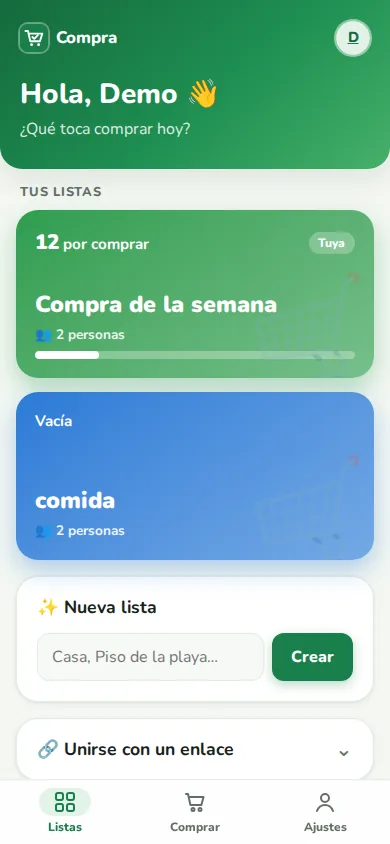
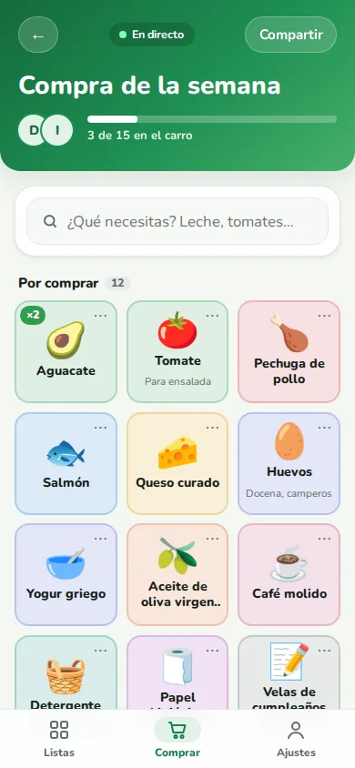
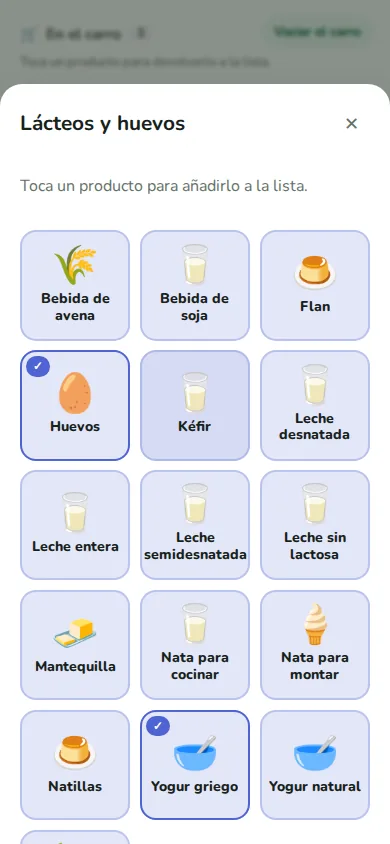
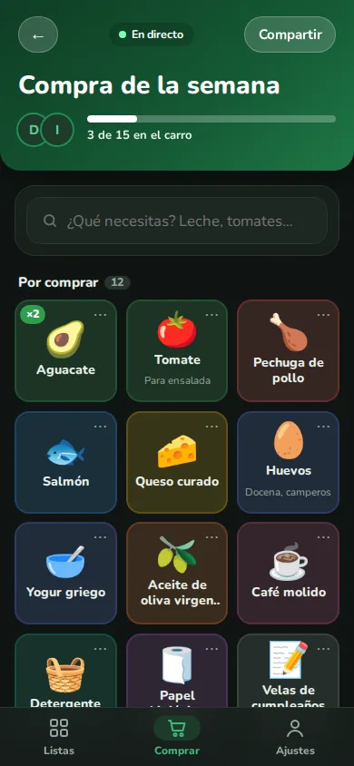

# Lista de la compra compartida

PWA para hacer la compra en compañía: listas compartidas por QR o enlace, productos agrupados por
secciones del supermercado y cambios en tiempo real entre todos los miembros.

- Login con email y contraseña (JWT) o con Google
- Buscador de productos tolerante a tildes y erratas, más productos de texto libre
- Varias listas por usuario, con propietario y miembros
- Marcar productos como cogidos en tiempo real (Server-Sent Events)
- Instalable en el móvil (PWA)

<p>
  
  
  
  
</p>

**Stack:** Spring Boot 4 · Java 21 · PostgreSQL 18 · React 19 · Vite · TypeScript · Caddy · Docker

## Desarrollo local

Requisitos: Docker, Java 21 y Node 24.

```bash
cp .env.example .env          # rellena POSTGRES_PASSWORD y JWT_SECRET (openssl rand -base64 48)
docker compose up -d          # PostgreSQL

cd backend && ./mvnw spring-boot:run       # API en http://localhost:8080
cd frontend && npm install && npm run dev  # web en http://localhost:5173
```

Tests: `cd backend && ./mvnw test` (necesita Docker) y `cd frontend && npm test`.

Más detalles de arquitectura y convenciones en [CLAUDE.md](CLAUDE.md).

## Despliegue en producción

Todo se ejecuta con Docker Compose: PostgreSQL, el backend y Caddy, que sirve la web, hace de
proxy hacia la API y obtiene y renueva solo el certificado HTTPS (Let's Encrypt).

### 1. Servidor y dominio
- Un servidor con Docker (por ejemplo un VPS con Ubuntu y 1–2 GB de RAM).
- En tu proveedor de dominio, un registro DNS **A** de `tudominio.com` → IP del servidor.
- Los puertos **80** y **443** abiertos en el firewall.

### 2. Configuración
En el servidor, clona el repositorio y crea el `.env` a partir de `.env.example`:

```bash
POSTGRES_PASSWORD=...          # nueva, distinta de la de desarrollo
JWT_SECRET=...                 # nuevo: openssl rand -base64 48
GOOGLE_CLIENT_ID=...
GOOGLE_CLIENT_SECRET=...
DOMAIN=tudominio.com
PUBLIC_URL=https://tudominio.com
```

### 3. Google
En Google Cloud Console → Google Auth Platform:
- **Clientes** → añade la URI de redireccionamiento `https://tudominio.com/login/oauth2/code/google`.
- **Información de la marca** → dominio autorizado `tudominio.com`, página principal y política de
  privacidad `https://tudominio.com/privacidad`.
- **Público** → *Publicar app* para que pueda entrar cualquiera.

Antes, cambia `CONTACT_EMAIL` en `frontend/src/pages/PrivacyPage.tsx` y revisa el texto.

### 4. Arrancar

```bash
docker compose -f docker-compose.prod.yml up -d --build
docker compose -f docker-compose.prod.yml ps        # los tres servicios en "running"/"healthy"
```

Para actualizar tras cambios: `git pull` y el mismo comando `up -d --build`.

### Copias de seguridad

```bash
docker compose -f docker-compose.prod.yml exec postgres pg_dump -U supermercado supermercado > backup.sql
```
