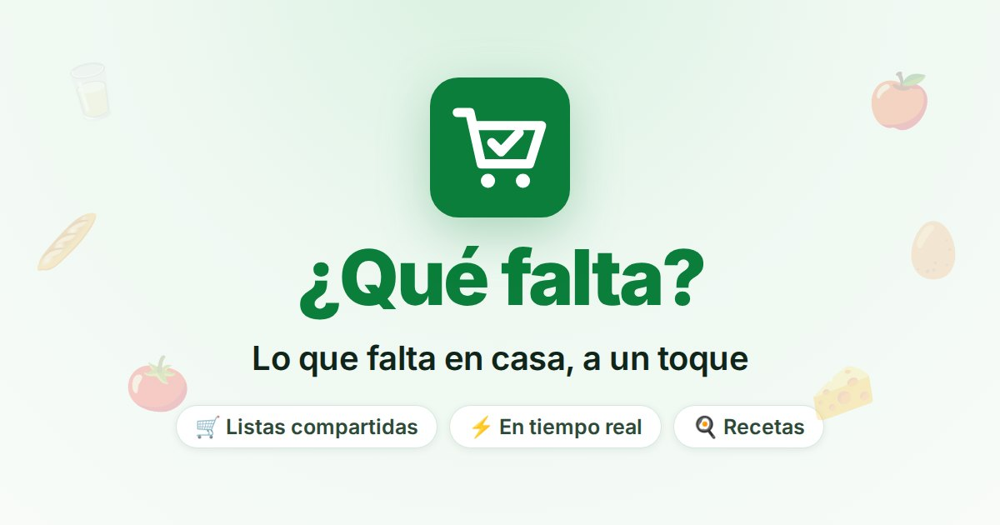
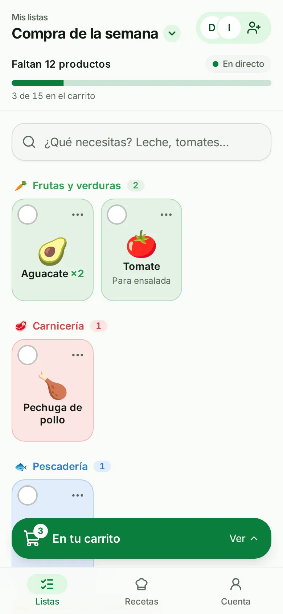
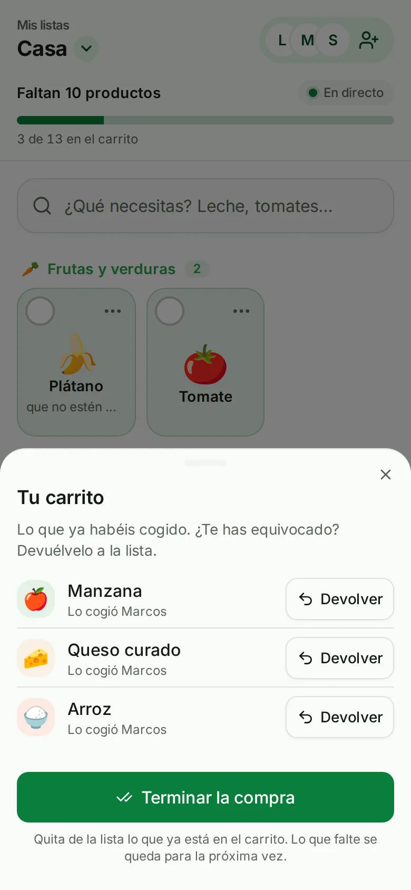
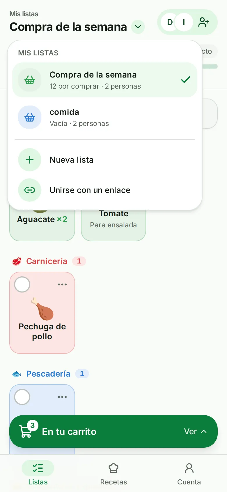
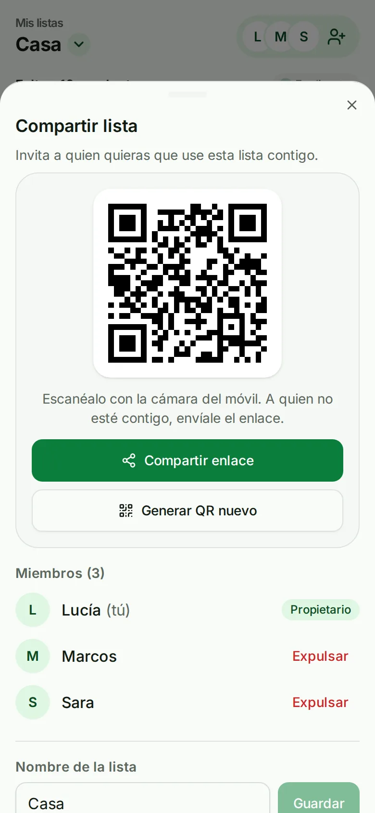
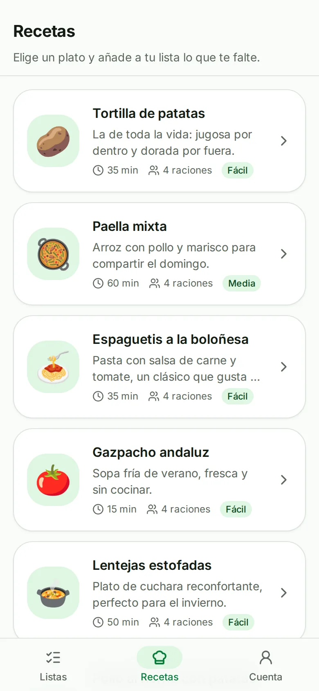
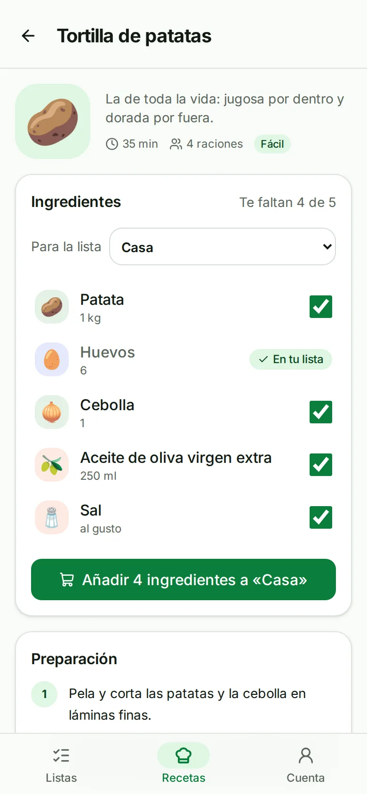
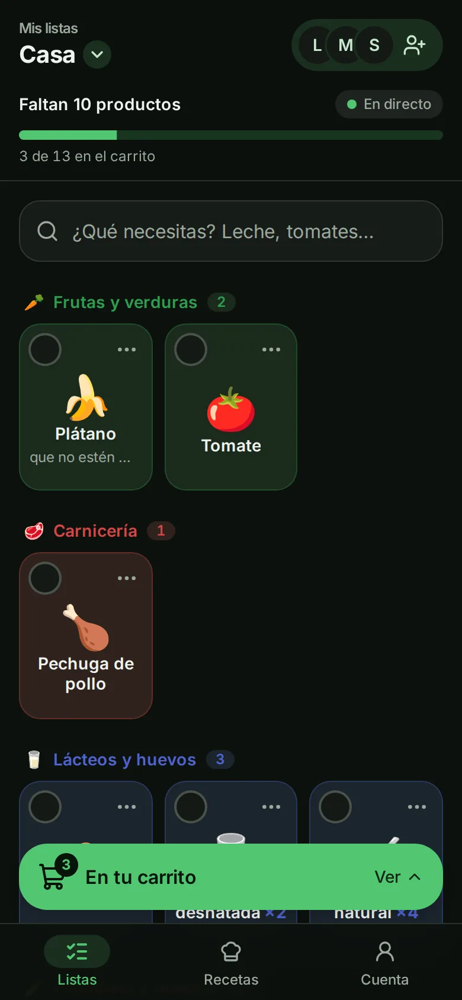
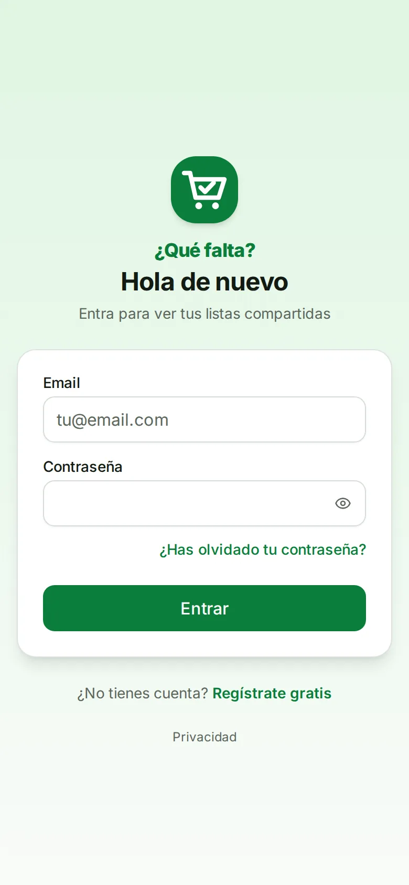

<div align="center">



# ¿Qué falta?

**La lista de la compra que compartes con tu casa, en tiempo real.**

[](https://supermercado-app-seven.vercel.app)

[](https://github.com/EloyRomero19/supermercado-app/actions/workflows/ci.yml)      

[Capturas](#capturas) · [Qué se puede hacer](#qué-se-puede-hacer) · [Lo más interesante](#lo-más-interesante-por-dentro) · [Tecnologías](#tecnologías) · [Ejecutarlo en local](#ejecutarlo-en-local) · [Despliegue](#despliegue)

</div>

---

Creas una lista, la compartes con tu familia o tus compañeros de piso con un **QR o un enlace**, y cada
uno apunta lo que falta en casa. En el súper, al meter algo en el carro **se marca al instante en el
móvil de todos**. Y si no sabes qué cocinar, el recetario te dice qué ingredientes te faltan y los añade
a la lista de una vez.

Funciona en cualquier navegador, está pensada primero para el móvil y se instala en la pantalla de
inicio como una app.

## Capturas

<table>
  <tr>
    <td align="center"><br><sub><b>Lo que falta, por secciones</b></sub></td>
    <td align="center"><br><sub><b>El carrito: quién cogió qué</b></sub></td>
    <td align="center"><br><sub><b>Varias listas</b></sub></td>
    <td align="center"><br><sub><b>Compartir con QR o enlace</b></sub></td>
  </tr>
  <tr>
    <td align="center"><br><sub><b>Recetario</b></sub></td>
    <td align="center"><br><sub><b>Qué te falta para cocinarla</b></sub></td>
    <td align="center"><br><sub><b>Modo oscuro</b></sub></td>
    <td align="center"><br><sub><b>Inicio de sesión</b></sub></td>
  </tr>
</table>

## Qué se puede hacer

| Función | Cómo es |
|---|---|
| 🛒 **Listas compartidas** | Varias listas (casa, piso de la playa, un cumpleaños…) con su propietario y sus miembros. La app abre directamente la que estás usando; las demás, desde «Mis listas ▾». |
| ⚡ **Tiempo real** | Lo que alguien añade, cambia o mete en el carro aparece al momento en los móviles de los demás. |
| 🔗 **Invitar** | Con un QR o un enlace, que en WhatsApp o Telegram llega con su tarjeta de vista previa. El propietario puede renovar el código o expulsar a alguien. |
| 🔎 **Buscador** | 220 productos en 13 secciones del súper. Entiende tildes y erratas («platano», «yogurt»). Lo que no esté se escribe a mano y la app le pone icono y sección. |
| 🧺 **Por secciones** | La lista se ordena por pasillos (fruta, carnicería, lácteos…), con cantidad y nota en cada producto, y «Utilizados recientemente» para repetir con un toque. |
| ✅ **Carrito** | Un toque mete el producto en el carro (con «Deshacer»). Se ve quién cogió cada cosa, y «Terminar la compra» deja la lista preparada para la próxima vez. |
| 🍳 **Recetas** | 15 platos de siempre. Cada uno marca qué ingredientes te faltan y los añade todos a la lista de una vez. |
| 🌗 **A tu gusto** | Modo claro, oscuro o automático. Aviso sin conexión e indicador «En directo». |
| 📱 **Instalable** | Se añade a la pantalla de inicio y abre al momento gracias a la caché del *service worker*. |
| 🔐 **Tu cuenta, tus datos** | Email y contraseña. Puedes borrar la cuenta desde la app: antes te enseña qué pasará con cada una de tus listas. |

## Lo más interesante por dentro

- **Tiempo real con Server-Sent Events.** Cada cambio publica un evento que solo se envía cuando la
  transacción de la base de datos se ha confirmado: nadie recibe un cambio que al final no se guardó.
  Si la conexión se corta, el cliente se reconecta solo y recarga lo que se perdió.
- **Sesión segura sin `localStorage`.** El *access token* (JWT, 15 min) vive solo en memoria. Se renueva
  con un *refresh token* en una cookie `HttpOnly` que cambia en cada uso; si alguien reutiliza uno
  viejo (señal de robo), se cierra toda esa sesión. La renovación se coordina entre pestañas.
- **Búsqueda tolerante a errores** en PostgreSQL con `pg_trgm` y `unaccent`: primero por inicio de
  palabra y, si no hay suerte, por parecido entre trigramas.
- **Autorización en cada operación.** A quien no es miembro de una lista se le responde *404*, para no
  revelar ni que existe. Límite de peticiones en el login, el registro y las invitaciones.
- **Arranque en frío de 40 s a 8 s.** En Vercel la API se apaga sin uso y arranca con 1 CPU. La imagen
  de producción usa la caché AOT de Java 25, que se «entrena» al construirla, y una configuración de la
  JVM pensada para una sola CPU.
- **Vista previa al compartir.** Etiquetas Open Graph generadas al compilar, con una variante propia para
  los enlaces de invitación («Te han invitado a una lista de la compra»).
- **Probado de verdad:** 105 tests de integración del backend contra un PostgreSQL real (Testcontainers)
  y 29 del frontend, que GitHub Actions ejecuta en cada *push*.

## Tecnologías

Un *monorepo* con dos aplicaciones: el **backend** (la API, en Java) y el **frontend** (la web, en
TypeScript), más lo necesario para desplegarlas.


La web y la API comparten dominio (la web reenvía `/api`), así que no hace falta CORS y la cookie de
sesión puede ser `SameSite=Strict`.

| Capa | Tecnologías |
|---|---|
| **Lenguajes** | Java 21 (~3 100 líneas + 1 800 de tests) · TypeScript (~5 900) · SQL · CSS (Tailwind) |
| **Backend** | Spring Boot 4.1 · Spring Web MVC · Spring Security (JWT, BCrypt) · Spring Data JPA / Hibernate · JdbcClient · Bean Validation · Flyway · SSE · Lombok · Maven |
| **Base de datos** | PostgreSQL 18 · `pg_trgm` + `unaccent` · Neon en producción |
| **Frontend** | React 19 · Vite 8 · React Router 8 · Tailwind CSS 4 · shadcn/ui + Radix UI · lucide-react · sonner · fetch-event-source · qrcode.react · vite-plugin-pwa (Workbox) |
| **Infraestructura** | Vercel (web + API en contenedor) · Docker y Docker Compose · Caddy (HTTPS automático) · GitHub Actions |
| **Calidad** | JUnit 5 + Testcontainers · Vitest · oxlint · TypeScript estricto |

<details>
<summary><b>Qué hace cada tecnología en el proyecto</b></summary>

### Backend

| Tecnología | Para qué |
|---|---|
| **Spring Boot 4.1** | El *framework* de la API. Código organizado por funcionalidad (`auth`, `list`, `item`, `recipe`…) y en capas: *Controller* → *Service* → *Repository*. |
| **Spring Web MVC** | Los *endpoints* REST bajo `/api` (JSON). Los errores siguen el estándar *Problem Details* (RFC 9457). |
| **Spring Security** | Valida el JWT en cada petición (*OAuth2 Resource Server*). Contraseñas cifradas con **BCrypt**. |
| **Spring Data JPA / Hibernate** | Guardar y leer usuarios, listas y productos sin SQL a mano. Bloqueo optimista (`@Version`) para que dos ediciones a la vez no se pisen. |
| **JdbcClient** | SQL directo donde conviene: el buscador y las recetas. |
| **Bean Validation** | Comprueba los datos de entrada antes de llegar a la lógica. |
| **Server-Sent Events** | El tiempo real: el servidor envía cada cambio por una conexión que el navegador mantiene abierta. |
| **Flyway** | Versiona el esquema: cada cambio es un `V{n}__descripcion.sql` que se aplica solo al arrancar. |
| **Spring Boot Actuator** | `/actuator/health`, para saber si la API está lista. |

### Frontend

| Tecnología | Para qué |
|---|---|
| **React 19** | La interfaz por componentes. |
| **Vite 8** | Desarrollo instantáneo y *build* optimizado. En desarrollo reenvía `/api` al backend. |
| **React Router 8** | Navegación entre pantallas sin recargar. |
| **Tailwind CSS 4** | Estilos con clases. Colores en variables OKLCH con contraste AA comprobado; el modo oscuro solo cambia esas variables. |
| **shadcn/ui + Radix UI** | Componentes accesibles (paneles, modales, menús) con foco, teclado y lector de pantalla resueltos. |
| **fetch-event-source** | Cliente SSE que envía el *token* en la cabecera y se reconecta solo. |
| **vite-plugin-pwa** | Manifiesto, iconos, pantallas de inicio de iPhone y *service worker* (cachea la web, nunca los datos de la API). |

### Infraestructura

| Tecnología | Para qué |
|---|---|
| **Vercel** | Producción: la web como sitio estático y la API como contenedor (`backend/Dockerfile.vercel`). |
| **Neon** | PostgreSQL gestionado en Frankfurt, junto a la API. |
| **Docker Compose + Caddy** | Alternativa en un servidor propio: base de datos, API, copias de seguridad diarias y servidor web con HTTPS automático. |
| **GitHub Actions** | En cada *push*: tests, *lint* y *build* del backend y del frontend. |

</details>

<details>
<summary><b>Seguridad</b></summary>

- Contraseñas con BCrypt (8–72 bytes); mensaje de error genérico al iniciar sesión, con el mismo
  tiempo de respuesta exista o no la cuenta.
- *Access token* solo en memoria; *refresh token* en cookie `HttpOnly; Secure; SameSite=Strict`,
  guardado como hash SHA-256, con rotación y revocación de la sesión entera si se reutiliza.
- Autorización por lista en la capa de servicio; productos buscados siempre por `(lista, producto)`.
- Borrar la cuenta pide la contraseña aunque haya sesión iniciada.
- Límite de peticiones en login, registro y renovación de sesión (por IP), y al unirse a listas y al
  borrar la cuenta (por usuario).
- Cabeceras de seguridad en producción: CSP estricta (solo scripts propios), HSTS, `nosniff`…

</details>

<details>
<summary><b>Estructura del proyecto</b></summary>

```
├── backend/                Spring Boot (Java)
│   └── src/main/
│       ├── java/com/miapp/backend/
│       │   ├── auth/       registro, login, JWT, refresh token, borrar cuenta
│       │   ├── user/       usuarios
│       │   ├── list/       listas, miembros, invitaciones
│       │   ├── item/       productos de cada lista
│       │   ├── product/    catálogo y buscador
│       │   ├── recipe/     recetario
│       │   ├── realtime/   tiempo real (SSE)
│       │   ├── ratelimit/  límite de peticiones
│       │   └── common/     errores y eventos
│       └── resources/db/migration/   esquema, catálogo y recetas (Flyway)
├── frontend/               React + TypeScript
│   └── src/
│       ├── api/            cliente de la API (token, renovación)
│       ├── auth/           sesión y rutas protegidas
│       ├── pages/          pantallas
│       ├── components/     componentes reutilizables (y ui/ de shadcn)
│       ├── items/          lista, carrito, recientes
│       ├── lists/          selector de listas, invitaciones, tiempo real
│       ├── products/       buscador y secciones del catálogo
│       ├── recipes/        lógica de recetas
│       ├── account/        borrar la cuenta
│       ├── theme/          modo claro/oscuro
│       └── pwa/            instalación y actualizaciones
├── backup/                 copias de seguridad (servidor propio)
├── docker-compose.yml      PostgreSQL para desarrollo
└── docker-compose.prod.yml producción en un servidor propio
```

</details>

## Ejecutarlo en local

Necesitas Docker, Java 21 y Node 24.

```bash
cp .env.example .env          # rellena POSTGRES_PASSWORD y JWT_SECRET (openssl rand -base64 48)
docker compose up -d          # PostgreSQL

cd backend && ./mvnw spring-boot:run       # API en http://localhost:8080
cd frontend && npm install && npm run dev  # web en http://localhost:5173
```

Tests y calidad:

```bash
cd backend && ./mvnw test      # tests de integración (necesita Docker: Testcontainers)
cd frontend && npm test        # Vitest
cd frontend && npm run lint    # oxlint
cd frontend && npm run build   # comprueba los tipos y genera la web de producción
```

Las convenciones y decisiones de arquitectura están en [CLAUDE.md](CLAUDE.md).

## Despliegue

La versión publicada está en **Vercel** con la base de datos en **Neon**. También está preparada para un
servidor propio con Docker Compose.

<details>
<summary><b>En Vercel + Neon (la versión publicada)</b></summary>

Dos proyectos de Vercel conectados a este repositorio y una base de datos PostgreSQL de Neon:

| Proyecto | *Root Directory* | Qué despliega |
|---|---|---|
| Web | `frontend` | La web estática. `frontend/vercel.json` reenvía `/api` a la API, sirve la vista previa de las invitaciones y pone las cabeceras de seguridad. |
| API | `backend` | El contenedor de `backend/Dockerfile.vercel`. |

Variables del proyecto de la API: `PORT=8080`, `POSTGRES_HOST`, `POSTGRES_DB`, `POSTGRES_USER`,
`POSTGRES_PASSWORD`, `POSTGRES_PARAMS=?sslmode=require` (Neon exige conexión cifrada), `JWT_SECRET` y
`FRONTEND_URL` (la URL pública de la web).

- **Región**: la API en la misma región que la base de datos (*Settings → Functions → Function
  Region*); aquí, Frankfurt (`fra1`).
- **Arranque en frío**: Vercel apaga la API tras 5 minutos sin uso; la siguiente petición espera unos
  8–10 s y la web avisa con «Despertando el servidor…».
- **Tiempo real**: Vercel corta las peticiones a los 5 minutos, así que la conexión SSE se renueva sola
  cada 4.
- **Copias de seguridad**: las hace Neon (con límites en el plan gratuito).

</details>

<details>
<summary><b>En un servidor propio con Docker Compose</b></summary>

PostgreSQL, la API, las copias de seguridad y Caddy, que sirve la web, hace de proxy hacia la API y
obtiene y renueva solo el certificado HTTPS (Let's Encrypt).

1. **Servidor y dominio**: un VPS con Docker y **al menos 2 GB de RAM**, un registro DNS **A** hacia su
   IP y los puertos **80** y **443** abiertos.
2. **Configuración**: clona el repositorio y crea el `.env` a partir de `.env.example`:

   ```bash
   POSTGRES_PASSWORD=...          # nueva, distinta de la de desarrollo
   JWT_SECRET=...                 # nuevo: openssl rand -base64 48
   DOMAIN=tudominio.com
   PUBLIC_URL=https://tudominio.com
   ```

3. **Arrancar**:

   ```bash
   docker compose -f docker-compose.prod.yml up -d --build
   docker compose -f docker-compose.prod.yml ps        # los cuatro servicios en "running"/"healthy"
   ```

   Para actualizar: `git pull` y el mismo `up -d --build`.

**Copias de seguridad automáticas.** El servicio `backup` copia la base de datos al arrancar y cada
24 h, y guarda las 14 más recientes en `backups/` (se ajusta con `BACKUP_INTERVAL_HOURS` y
`BACKUP_KEEP`). Para tener también copias fuera del servidor:

```bash
ssh root@tudominio.com 'cat "$(ls -1 /ruta/al/proyecto/backups/*.dump | sort | tail -1)"' > quefalta-$(date +%F).dump
```

**Restaurar** una copia (pide confirmación y lo hace en una sola transacción: si falla, todo queda
como estaba):

```bash
sudo ./backup/restore.sh backups/quefalta-20261014-040000.dump
```

</details>

---

<div align="center">
<sub>Hecho por <a href="https://github.com/EloyRomero19">Eloy Romero</a> · Java, Spring Boot, React y PostgreSQL</sub>
</div>
