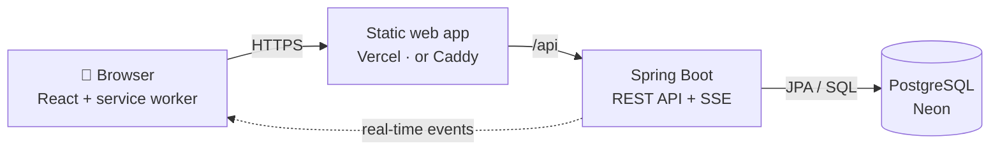

<div align="center">


# ¿Qué falta?

**The shopping list you share with your household, in real time.**

<sub>*¿Qué falta?* is Spanish for *"What's missing?"*. The app and its screenshots are in Spanish; app texts are quoted as they appear, with a translation.</sub>

[](https://supermercado-app-seven.vercel.app)

[](https://github.com/EloyRomero19/supermercado-app/actions/workflows/ci.yml)      

[Screenshots](#screenshots) · [Features](#features) · [Under the hood](#under-the-hood) · [Tech stack](#tech-stack) · [Run it locally](#run-it-locally) · [Deployment](#deployment)

</div>

---

Create a list, share it with your family or flatmates through a **QR code or a link**, and everyone adds
what's running out at home. At the supermarket, whatever goes into the cart is **checked off instantly
on everyone's phone**. And if you don't know what to cook, the recipe book tells you which ingredients
you're missing and adds them all to the list at once.

It runs in any browser, is designed mobile-first and can be installed on the home screen like an app.

## Screenshots

<table>
  <tr>
    <td align="center"><br><sub><b>What's missing, by section</b></sub></td>
    <td align="center"><br><sub><b>The cart: who picked up what</b></sub></td>
    <td align="center"><br><sub><b>Several lists</b></sub></td>
    <td align="center"><br><sub><b>Share with a QR code or link</b></sub></td>
  </tr>
  <tr>
    <td align="center"><br><sub><b>Recipe book</b></sub></td>
    <td align="center"><br><sub><b>What you need to cook it</b></sub></td>
    <td align="center"><br><sub><b>Dark mode</b></sub></td>
    <td align="center"><br><sub><b>Sign in</b></sub></td>
  </tr>
</table>

## Features

| Feature | What it does |
|---|---|
| 🛒 **Shared lists** | Several lists (home, beach flat, a birthday party…), each with an owner and members. The app opens the one you're using; switch from the title, «Mis listas ▾» (*my lists*). |
| ⚡ **Real time** | Whatever someone adds, edits or puts in the cart shows up instantly on everyone else's phone. |
| 🔗 **Invites** | Through a QR code or a link, which arrives on WhatsApp or Telegram with a rich preview card. The owner can renew the code or remove members. |
| 🔎 **Search** | 220 products across 13 supermarket sections. Tolerant to missing accents and typos («platano», «yogurt»). Anything not in the catalog can be typed in, and the app guesses its icon and section. |
| 🧺 **By section** | The list is sorted by aisle (fruit, butcher, dairy…), with quantity and a note per product, plus «Utilizados recientemente» (*recently used*) to re-add anything with one tap. |
| ✅ **Cart** | One tap puts a product in the cart, with «Deshacer» (*undo*). You can see who picked up each item, and «Terminar la compra» (*finish shopping*) leaves the list ready for next time. |
| 🍳 **Recipes** | 15 classic Spanish dishes. Each one marks which ingredients you're missing and adds them all to the list at once. |
| 🌗 **Your way** | Light, dark or automatic theme. Offline notice and an «En directo» (*live*) indicator. |
| 📱 **Installable** | Add it to the home screen; it opens instantly thanks to the *service worker* cache. |
| 🔐 **Your account, your data** | Email and password. You can delete your account from the app, which first shows what will happen to each of your lists. |

## Under the hood

- **Real time with Server-Sent Events.** Every change publishes an event that is only sent once the
  database transaction has committed, so nobody ever receives a change that wasn't saved. If the
  connection drops, the client reconnects on its own and reloads whatever it missed.
- **Secure sessions without `localStorage`.** The *access token* (JWT, 15 min) lives in memory only. It's
  renewed with a *refresh token* in an `HttpOnly` cookie that rotates on every use; if an old one is
  reused (a sign of theft), the whole session is revoked. Renewal is coordinated across browser tabs.
- **Typo-tolerant search** in PostgreSQL with `pg_trgm` and `unaccent`: prefix matching first and, if
  that finds nothing, trigram similarity.
- **Authorization on every operation.** Non-members of a list get a *404*, so they can't even tell it
  exists. Rate limiting on sign-in, sign-up and invites.
- **Cold start cut from 40 s to 8 s.** On Vercel the API scales to zero and boots on a single CPU. The
  production image uses Java 25's AOT cache, "trained" while the image is built, plus JVM settings tuned
  for one CPU.
- **Link previews.** Open Graph tags generated at build time, with a dedicated variant for invite links
  («Te han invitado a una lista de la compra», *you've been invited to a shopping list*).
- **Properly tested:** 105 backend integration tests against a real PostgreSQL (Testcontainers) and 29
  frontend tests, run by GitHub Actions on every *push*.

## Tech stack

A *monorepo* with two applications: the **backend** (the API, in Java) and the **frontend** (the web
app, in TypeScript), plus everything needed to deploy them.



The web app and the API share the same domain (the web app forwards `/api`), so there's no CORS and the
session cookie can be `SameSite=Strict`.

| Layer | Technologies |
|---|---|
| **Languages** | Java 21 (~3,100 lines + 1,800 of tests) · TypeScript (~5,900) · SQL · CSS (Tailwind) |
| **Backend** | Spring Boot 4.1 · Spring Web MVC · Spring Security (JWT, BCrypt) · Spring Data JPA / Hibernate · JdbcClient · Bean Validation · Flyway · SSE · Lombok · Maven |
| **Database** | PostgreSQL 18 · `pg_trgm` + `unaccent` · Neon in production |
| **Frontend** | React 19 · Vite 8 · React Router 8 · Tailwind CSS 4 · shadcn/ui + Radix UI · lucide-react · sonner · fetch-event-source · qrcode.react · vite-plugin-pwa (Workbox) |
| **Infrastructure** | Vercel (static web app + API container) · Docker and Docker Compose · Caddy (automatic HTTPS) · GitHub Actions |
| **Quality** | JUnit 5 + Testcontainers · Vitest · oxlint · strict TypeScript |

<details>
<summary><b>What each technology does in the project</b></summary>

### Backend

| Technology | Purpose |
|---|---|
| **Spring Boot 4.1** | The API framework. Code is organized by feature (`auth`, `list`, `item`, `recipe`…) and in layers: *Controller* → *Service* → *Repository*. |
| **Spring Web MVC** | REST *endpoints* under `/api` (JSON). Errors follow the *Problem Details* standard (RFC 9457). |
| **Spring Security** | Validates the JWT on every request (*OAuth2 Resource Server*). Passwords hashed with **BCrypt**. |
| **Spring Data JPA / Hibernate** | Reading and writing users, lists and items without hand-written SQL. Optimistic locking (`@Version`) so two simultaneous edits don't overwrite each other. |
| **JdbcClient** | Plain SQL where it fits better: search and recipes. |
| **Bean Validation** | Checks incoming data before it reaches the business logic. |
| **Server-Sent Events** | Real time: the server pushes every change over a connection the browser keeps open. |
| **Flyway** | Versions the schema: each change is a `V{n}__description.sql` file applied automatically at startup. |
| **Spring Boot Actuator** | `/actuator/health`, to know when the API is ready. |

### Frontend

| Technology | Purpose |
|---|---|
| **React 19** | Component-based UI. |
| **Vite 8** | Instant dev server and optimized production build. Proxies `/api` to the backend during development. |
| **React Router 8** | Client-side navigation between screens. |
| **Tailwind CSS 4** | Utility-class styling. Colors are OKLCH CSS variables with verified AA contrast; dark mode only swaps those variables. |
| **shadcn/ui + Radix UI** | Accessible components (sheets, dialogs, menus) with focus, keyboard and screen-reader support built in. |
| **fetch-event-source** | SSE client that sends the *token* in a header and reconnects automatically. |
| **vite-plugin-pwa** | Manifest, icons, iPhone splash screens and the *service worker* (caches the app, never API data). |

### Infrastructure

| Technology | Purpose |
|---|---|
| **Vercel** | Production: the web app as a static site and the API as a container (`backend/Dockerfile.vercel`). |
| **Neon** | Managed PostgreSQL in Frankfurt, next to the API. |
| **Docker Compose + Caddy** | Self-hosting alternative: database, API, daily backups and a web server with automatic HTTPS. |
| **GitHub Actions** | On every *push*: tests, *lint* and *build* for backend and frontend. |

</details>

<details>
<summary><b>Security</b></summary>

- Passwords hashed with BCrypt (8–72 bytes); generic error message on sign-in, with the same response
  time whether or not the account exists.
- *Access token* in memory only; *refresh token* in an `HttpOnly; Secure; SameSite=Strict` cookie,
  stored as a SHA-256 hash, rotated on every use and revoking the whole session if reused.
- Per-list authorization in the service layer; items are always looked up by `(list, item)`.
- Deleting the account requires the password, even with an active session.
- Rate limiting on sign-in, sign-up and session renewal (per IP), and on joining lists and deleting the
  account (per user).
- Security headers in production: strict CSP (own scripts only), HSTS, `nosniff`…

</details>

<details>
<summary><b>Project structure</b></summary>

```
├── backend/                Spring Boot (Java)
│   └── src/main/
│       ├── java/com/miapp/backend/
│       │   ├── auth/       sign-up, sign-in, JWT, refresh token, account deletion
│       │   ├── user/       users
│       │   ├── list/       lists, members, invites
│       │   ├── item/       items in each list
│       │   ├── product/    catalog and search
│       │   ├── recipe/     recipe book
│       │   ├── realtime/   real time (SSE)
│       │   ├── ratelimit/  rate limiting
│       │   └── common/     errors and events
│       └── resources/db/migration/   schema, catalog and recipes (Flyway)
├── frontend/               React + TypeScript
│   └── src/
│       ├── api/            API client (token, renewal)
│       ├── auth/           session and protected routes
│       ├── pages/          screens
│       ├── components/     reusable components (and shadcn's ui/)
│       ├── items/          list, cart, recent items
│       ├── lists/          list switcher, invites, real time
│       ├── products/       search and catalog sections
│       ├── recipes/        recipe logic
│       ├── account/        account deletion
│       ├── theme/          light/dark mode
│       └── pwa/            install and updates
├── backup/                 backups (self-hosting)
├── docker-compose.yml      PostgreSQL for development
└── docker-compose.prod.yml self-hosted production
```

</details>

## Run it locally

You need Docker, Java 21 and Node 24.

```bash
cp .env.example .env          # set POSTGRES_PASSWORD and JWT_SECRET (openssl rand -base64 48)
docker compose up -d          # PostgreSQL

cd backend && ./mvnw spring-boot:run       # API at http://localhost:8080
cd frontend && npm install && npm run dev  # web app at http://localhost:5173
```

Tests and quality checks:

```bash
cd backend && ./mvnw test      # integration tests (needs Docker: Testcontainers)
cd frontend && npm test        # Vitest
cd frontend && npm run lint    # oxlint
cd frontend && npm run build   # type-checks and builds the production web app
```

Conventions and architecture decisions are documented (in Spanish) in [CLAUDE.md](CLAUDE.md).

## Deployment

The live version runs on **Vercel** with the database on **Neon**. It's also ready to self-host with
Docker Compose.

<details>
<summary><b>On Vercel + Neon (the live version)</b></summary>

Two Vercel projects connected to this repository and a Neon PostgreSQL database:

| Project | *Root Directory* | What it deploys |
|---|---|---|
| Web | `frontend` | The static web app. `frontend/vercel.json` forwards `/api` to the API, serves the invite link preview and sets the security headers. |
| API | `backend` | The container from `backend/Dockerfile.vercel`. |

API project variables: `PORT=8080`, `POSTGRES_HOST`, `POSTGRES_DB`, `POSTGRES_USER`,
`POSTGRES_PASSWORD`, `POSTGRES_PARAMS=?sslmode=require` (Neon requires an encrypted connection),
`JWT_SECRET` and `FRONTEND_URL` (the web app's public URL).

- **Region**: put the API in the same region as the database (*Settings → Functions → Function Region*);
  here, Frankfurt (`fra1`).
- **Cold start**: Vercel stops the API after 5 minutes without traffic; the next request waits about
  8–10 s and the web app shows «Despertando el servidor…» (*waking up the server*).
- **Real time**: Vercel cuts requests at 5 minutes, so the SSE connection renews itself every 4.
- **Backups**: handled by Neon (limited on the free plan).

</details>

<details>
<summary><b>Self-hosted with Docker Compose</b></summary>

PostgreSQL, the API, backups and Caddy, which serves the web app, proxies the API and obtains and
renews the HTTPS certificate automatically (Let's Encrypt).

1. **Server and domain**: a VPS with Docker and **at least 2 GB of RAM**, a DNS **A** record pointing to
   its IP and ports **80** and **443** open.
2. **Configuration**: clone the repository and create `.env` from `.env.example`:

   ```bash
   POSTGRES_PASSWORD=...          # a new one, different from development
   JWT_SECRET=...                 # a new one: openssl rand -base64 48
   DOMAIN=yourdomain.com
   PUBLIC_URL=https://yourdomain.com
   ```

3. **Start**:

   ```bash
   docker compose -f docker-compose.prod.yml up -d --build
   docker compose -f docker-compose.prod.yml ps        # all four services "running"/"healthy"
   ```

   To update: `git pull` and the same `up -d --build`.

**Automatic backups.** The `backup` service dumps the database at startup and every 24 h, keeping the
14 most recent in `backups/` (configurable with `BACKUP_INTERVAL_HOURS` and `BACKUP_KEEP`). To also keep
copies off the server:

```bash
ssh root@yourdomain.com 'cat "$(ls -1 /path/to/project/backups/*.dump | sort | tail -1)"' > quefalta-$(date +%F).dump
```

**Restoring** a backup (asks for confirmation and runs in a single transaction: if it fails, nothing
changes):

```bash
sudo ./backup/restore.sh backups/quefalta-20261014-040000.dump
```

</details>

---

<div align="center">
<sub>Built by <a href="https://github.com/EloyRomero19">Eloy Romero</a> · Java, Spring Boot, React and PostgreSQL</sub>
</div>
